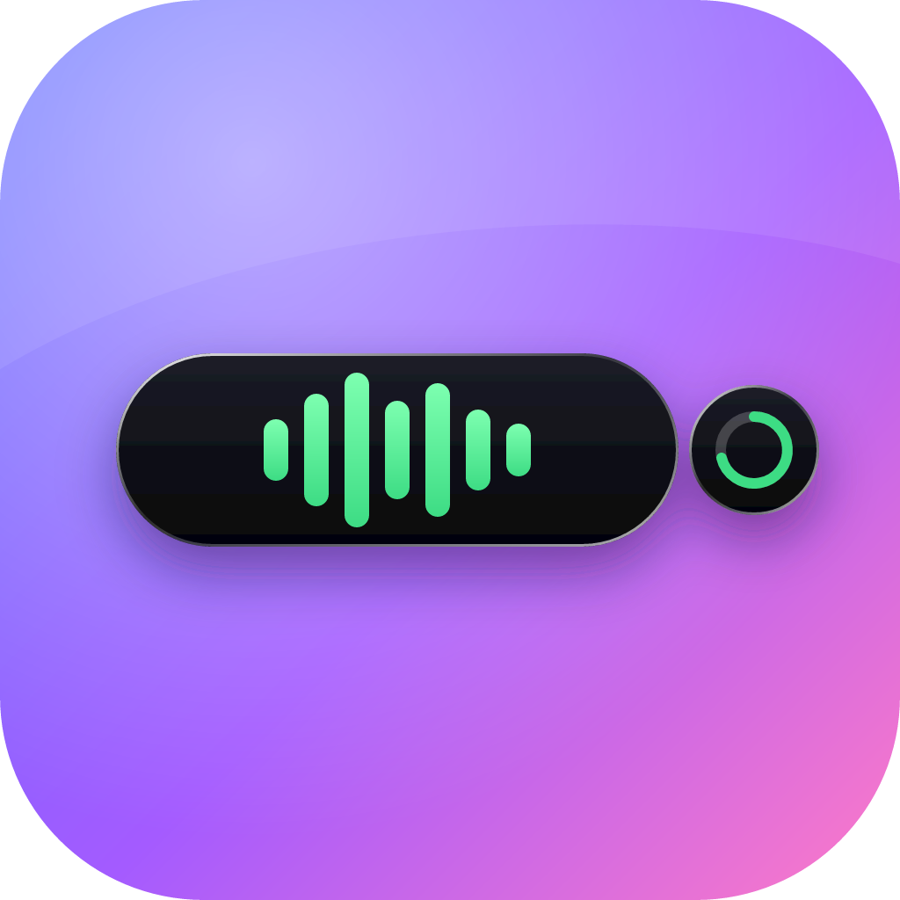

<div align="center">



# Astra Isle

**A liquid, always-on-top island for the top of your screen, for Windows and macOS.**

It sits as a small black pill and melts open to show your music, timers, alerts, files and friends.

[](https://github.com/sauqyy/dynamicisland/releases/latest)




</div>

## Download

Grab the latest build from [**Releases**](https://github.com/sauqyy/dynamicisland/releases/latest):

| Platform | File |
|---|---|
| Windows 10 / 11 | `AstraIsle_<version>_x64-setup.exe` |
| macOS (Intel and Apple silicon) | `Astra.Isle_<version>_universal.dmg` |

The app checks GitHub for updates on its own and shows what's new after each update.

## Features

### Now Playing with synced lyrics

Works with anything that uses the system media controls: Spotify, YouTube in the browser, Apple Music, VLC and more.

- Cover art, title, artist, a seekable timeline and previous / play / next on one row
- Time-synced lyrics from [LRCLIB](https://lrclib.net). Click a line to jump to it
- While music plays, the pill shows the cover, the current lyric and an equalizer (Bars, Wave or Pulse, tinted by the album art, your accent, or a colour you pick)
- A short *Now playing* alert when the song changes

### Timers that split off the island


Timer, stopwatch with laps, and Pomodoro. A running timer splits off the island as a gooey bubble and drains as it counts down, so you can see it at a glance next to whatever else the island is showing.

### Quick alerts


Volume, brightness, battery, charging and downloads appear for a moment and fold back into the pill. Progress (charging, downloads) runs along the island's bottom edge.

### Friends, group chats and voice calls


- Add friends, see who's online, and chat from the island, or go fullscreen with your contacts on the left
- Group chats with icons, colours, sender names and read receipts
- One-to-one and group voice calls (up to 6 people). Calls ring in the island with Answer and Decline, then become a small pill with the timer, mute, deafen and hang up
- Pick your microphone and speaker in Settings

### Astra, your voice assistant (beta)

Astra is a little assistant who lives in the island. She is off until you turn her on in Settings, and her listening model downloads once, after she tells you how big it is.

- **Wake her** with a global shortcut (press or hold, your choice), then just say what you need
- **Her eyes live in the pill.** In the resting pill Astra's eyes blink and look around, take on the colour and accessories you give her, and follow your voice while she listens. Turn on *Only the eyes* to hide the clock and leave just her
- **Talks back** with a local neural voice, or a cloud voice if you prefer. You can also type to her on the Astra page
- Runs on a local model or Claude, with a short or normal reply length and a persona you pick

#### Voice commands

| Say something like | Astra will |
|---|---|
| "Open Spotify", "open VS Code" | Launch an app, file or folder |
| "Search the web for ..." | Search, or open an https link |
| "Pause", "play", "next song", "previous song" | Control the music that's playing |
| "Volume up", "volume down", "set volume to 40", "mute" | Change the system volume |
| "Set a timer for 10 minutes" | Start a timer on the island |
| "Add buy milk to my to-do" | Add a task |
| Your own routine names | Run a routine (several actions in one phrase) |
| "Lock the computer", "sleep", "restart", "shut down" | Power actions, off until you enable them |
| Any question | Answer it |

You choose what Astra may do in Settings, one tool at a time, and she asks before opening a file path she doesn't already trust. You can add your own aliases and routines too.

### And more

| | |
|---|---|
| **Weather** | Current conditions and forecast |
| **To-do and Notes** | Add tasks and jot things down without leaving what you're doing |
| **Shelf** | Drop files on the island to hold them, then drag them out where you need them |
| **Clipboard** | Recent clipboard history, one click to copy again |
| **Apps** | Your favourite apps, one click away |
| **Themes** | Dark, light and glass, with your own accent colour |
| **Sounds** | Small sound effects for opening, closing and alerts, with a few packs to pick from |

## How it works

The island is a transparent, frameless, always-on-top [Tauri 2](https://tauri.app) window with a React UI. The liquid feel comes from spring animations ([Motion](https://motion.dev)) for the shape and an SVG goo filter (blur, then sharpen the alpha) that lets bubbles melt together and snap apart. Text is drawn outside the filter so it stays sharp.

Rust reads the system state: media sessions and cover art, battery, volume and brightness, fullscreen apps, and files, with separate backends for Windows (WinRT) and macOS. Friends, chats and presence run on [Supabase](https://supabase.com), and calls connect straight between apps over WebRTC.

| Layer | Tech |
|---|---|
| Shell | Tauri 2 (Rust) |
| UI | React 19, TypeScript, Vite |
| Animation | Motion springs + SVG goo filter |
| Backend | Supabase (auth, database, realtime) |
| Calls | WebRTC |

## Development

You'll need [Node.js](https://nodejs.org), and for the desktop app, [Rust](https://rustup.rs) plus the [Tauri prerequisites](https://tauri.app/start/prerequisites/) (MSVC Build Tools and WebView2 on Windows, Xcode Command Line Tools on macOS).

```bash
npm install
```

```bash
npm run dev
```

opens a browser demo at http://localhost:5173 with fake data and a demo panel, which is the fastest way to work on the UI.

```bash
npm run tauri dev
```

runs the real app.

### Social features (optional)

Friends, chats and calls need a Supabase project:

1. Copy `.env.example` to `.env.local` and fill in your project URL and anon key.
2. Run [`supabase/schema.sql`](supabase/schema.sql), then [`supabase/groups.sql`](supabase/groups.sql), in the Supabase SQL editor.

See [`supabase/README.md`](supabase/README.md) for details. Without it, everything else still works.

### Project layout

```
src/
  App.tsx        island state and which page is shown
  island/        the island shell, alert icons, page bar
  widgets/       one component per page (media, timer, chat, Astra, ...)
  mascot/        Astra's eyes and accessories
  lib/           hooks and helpers (media, lyrics, calls, settings, ...)
src-tauri/       Rust side: windows, tray, media, system and file APIs
supabase/        database schema for friends, groups and chats
```

The original design notes and roadmap are in [PLAN.md](PLAN.md).
